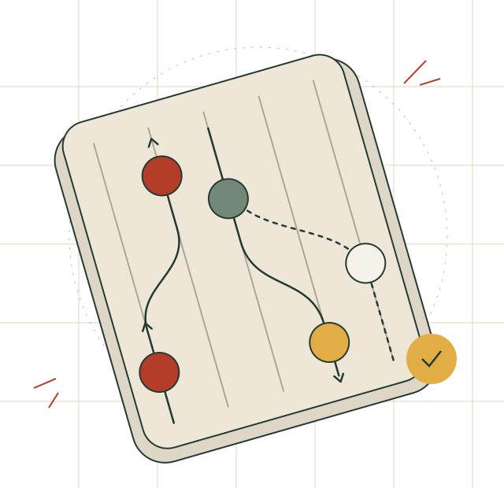

<section class="hero wrap" aria-labelledby="hero-title">

 Inclusive circus. Connected across Europe.

<h1 id="hero-title">More ways into <em>movement.</em></h1>

We bring people, practices and ideas together to make circus and movement more accessible.

Rooted in Functional Juggling. Growing through shared experience, curiosity and a belief that there is always another way in.

<a class="button" href="approach/">Explore our approach ↗</a><a class="text-link" href="network/">Meet the network →</a>

<figure class="hero-visual">

Room for a different pathway.↗

<figcaption>Many starting points. A shared space.FIG. 01</figcaption>
</figure>
</section>

Our current connections
Hungary · Italy · Germany · Greece · Poland
<a href="network/" aria-label="Explore our current network connections">↗</a>

<section class="intro-section wrap" aria-labelledby="starting-question">

01 / A shared starting point

<h2 id="starting-question">What becomes possible when we adapt <em>the practice?</em></h2>
A ball can roll, travel along a board or move between two people. There are many ways to explore rhythm, coordination and connection.

We are interested in how a practice can respond to the person taking part: their interests, choices and ways of moving. Functional Juggling is an important influence on that work, within a wider field of inclusive circus pedagogy.
<a class="text-link" href="approach/">Why we work this way ↗</a>

</section>

<section class="practice-section" aria-labelledby="practice-title">

02 / From local practice to shared knowledge
<h2 id="practice-title">Practice. Reflect. <em>Share.</em></h2>

What we learn in one place can open possibilities somewhere else.

<a class="practice-row" href="approach/">01<h3>Find another way in</h3>
Explore materials, tasks and facilitation that create different ways to participate.
↗</a>
<a class="practice-row" href="work/">02<h3>Learn across borders</h3>
Discover the exchanges and case studies connecting our local experiences.
↗</a>
<a class="practice-row" href="open-practice/">03<h3>Keep knowledge moving</h3>
Make methods easier to find, understand, credit and build on together.
↗</a>

</section>

<section class="work-section wrap" aria-labelledby="work-title">

03 / A window into the work
<h2 id="work-title">Real settings. <em>Different possibilities.</em></h2>
Our connections have grown through Erasmus+ exchanges and the work of individual organisations. An existing collection of case studies offers a place to begin.
<a class="text-link" href="work/">Explore our shared work ↗</a>

<article class="publication">
A collection of case studies
Let’s talk about inclusive <em>circus practice.</em>

<i></i><i></i><i></i><i></i><i></i>
Learning from different contexts

Existing publication · 2025<a href="https://nica-ev.github.io/circuswiki/en/Lets-talk-about-inclusive-circus-practice/">Read on CircusWiki ↗</a>
</article>
</section>

<section class="invitation">

An open invitation
<h2>Bring your questions. <em>We’ll bring ours.</em></h2>

Working in inclusive circus, movement or education? Let’s exchange experiences and explore what we could do together.
<a class="button button-light" href="connect/">Connect with the network ↗</a>

</section>
